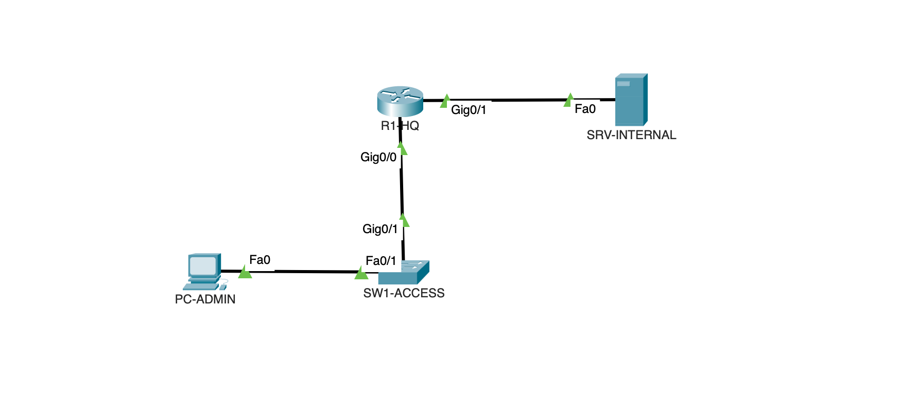
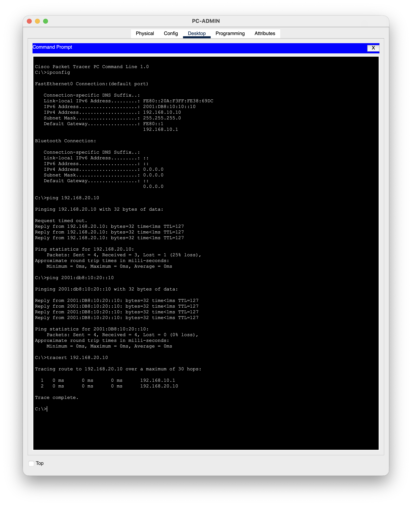

# Project 01: Dual-Stack Small Office Network

  

## 1. Business requirement
Emetonjor Solutions Ltd needs its administration staff to reach an internal server on a separate network, over both IPv4 and IPv6, so the office is ready for IPv6 without losing IPv4 services.

## 2. Solution summary
- One Cisco 2911 router (R1-HQ) routing between an Admin LAN and a Server LAN
- Dual-stack addressing (IPv4 /24 and IPv6 /64) on every interface
- Static link-local gateway (FE80::1) on both router interfaces for predictable IPv6 default gateways

## 3. Topology

    PC-ADMIN (Fa0) --- (Fa0/1) SW1-ACCESS (Gi0/1) --- (G0/0) R1-HQ (G0/1) --- (Fa0) SRV-INTERNAL

## 4. Addressing plan
| Device | Interface | IPv4 | Mask | IPv6 | Gateway (v4 / v6) |
|---|---|---|---|---|---|
| R1-HQ | G0/0 | 192.168.10.1 | 255.255.255.0 | 2001:db8:10:10::1/64, FE80::1 | N/A |
| R1-HQ | G0/1 | 192.168.20.1 | 255.255.255.0 | 2001:db8:10:20::1/64, FE80::1 | N/A |
| PC-ADMIN | Fa0 | 192.168.10.10 | 255.255.255.0 | 2001:db8:10:10::10/64 | 192.168.10.1 / FE80::1 |
| SRV-INTERNAL | Fa0 | 192.168.20.10 | 255.255.255.0 | 2001:db8:10:20::10/64 | 192.168.20.1 / FE80::1 |

`2001:db8::/32` is the IPv6 documentation prefix (RFC 3849), used here because this is a lab.

## 5. Design decisions
| Decision | Reason | Alternative considered |
|---|---|---|
| Static link-local FE80::1 on router interfaces | Same, easy-to-remember IPv6 gateway on every LAN; it does not change if hardware is replaced | Auto-generated EUI-64 link-local (changes with MAC address) |
| /64 for every IPv6 LAN | Required for SLAAC and standard practice | Longer prefixes (break SLAAC) |
| Interface descriptions | Faster triage: engineers can see what each port connects to | No descriptions |
| `no ip domain-lookup` | Stops the router freezing on mistyped commands while it tries DNS | Default behaviour |

## 6. Implementation
Full configuration: [configs/R1-HQ_running-config.txt](configs/R1-HQ_running-config.txt)

    interface GigabitEthernet0/0
     description LAN-ADMIN via SW1-ACCESS
     ip address 192.168.10.1 255.255.255.0
     ipv6 address FE80::1 link-local
     ipv6 address 2001:DB8:10:10::1/64
     no shutdown
    !
    interface GigabitEthernet0/1
     description LAN-SERVERS to SRV-INTERNAL
     ip address 192.168.20.1 255.255.255.0
     ipv6 address FE80::1 link-local
     ipv6 address 2001:DB8:10:20::1/64
     no shutdown
    !
    ipv6 unicast-routing

## 7. Verification
| Test | Command | Expected | Result |
|---|---|---|---|
| Router IPv4 interfaces | `show ip interface brief` | G0/0 and G0/1 up/up | Pass ([output](verification/R1-HQ_show-ip-int-brief.txt)) |
| Router IPv6 interfaces | `show ipv6 interface brief` | FE80::1 + global address on both | Pass ([output](verification/R1-HQ_show-ipv6-int-brief.txt)) |
| PC addressing | `ipconfig` | Correct IPv4/IPv6 and gateways | Pass |
| IPv4 end-to-end | `ping 192.168.20.10` | Replies, TTL=127 | Pass (3/4, first lost to ARP) |
| IPv6 end-to-end | `ping 2001:db8:10:20::10` | 4/4 replies | Pass (0% loss) |
| Path | `tracert 192.168.20.10` | 192.168.10.1 then 192.168.20.10 | Pass |

**Reading the results:** TTL=127 (128 minus 1) shows the packet crossed one router. The first IPv4 ping timed out because the PC and router had to resolve MAC addresses with ARP first. IPv6 did not lose a packet because Neighbor Discovery had already completed.

## 8. Troubleshooting
| Ticket | Priority | Summary |
|---|---|---|
| [TKT-001](troubleshooting/TKT-001-command-in-wrong-mode.md) | P4 | Interface command rejected - entered in wrong IOS mode |
| [TKT-002](troubleshooting/TKT-002-wrong-default-gateway.md) | P3 | One user cannot reach server - incorrect default gateway |
| [TKT-003](troubleshooting/TKT-003-router-interface-shutdown.md) | P2 | Server LAN unreachable - router interface shut down |
| [TKT-004](troubleshooting/TKT-004-ipv6-routing-disabled.md) | P3 | IPv6 failing, IPv4 working - IPv6 routing disabled |

**Method:** define the problem, then scope (one user or many, IPv4 or IPv6), then test bottom-up (gateway first, then far end), then confirm the root cause, fix, verify, update the customer, and record prevention.

## 9. Security considerations
- A login banner warns that access is restricted.
- In this lab version the console and VTY lines have no passwords. That is added in Project 05 (SSH, local users, `service password-encryption`).

## 10. What I would do in production
- Turn on `ipv6 cef` (off by default in Packet Tracer) for hardware-accelerated IPv6 forwarding
- Add SSH-only management, AAA and an NTP source for accurate log timestamps
- Use DHCP / SLAAC instead of static addressing for user devices
- Separate departments with VLANs (Project 02)

## 11. Lessons learned
- Check the IOS prompt before typing: interface commands only work in `(config)#` mode.
- A router will not forward IPv6 until `ipv6 unicast-routing` is enabled.
- The first lost ping is ARP doing its job, not a fault.
- Saving `show` output as text files makes the evidence searchable and easy to compare.

## 12. CCNA 200-301 v1.1 objectives covered
- 1.1 Network components (routers, switches, endpoints, servers)
- 1.6 Configure and verify IPv4 addressing and subnetting
- 1.8 Configure and verify IPv6 addressing and prefix
- 1.9 IPv6 address types (global unicast, link-local)
- 1.10 Verify IP parameters on client OS
