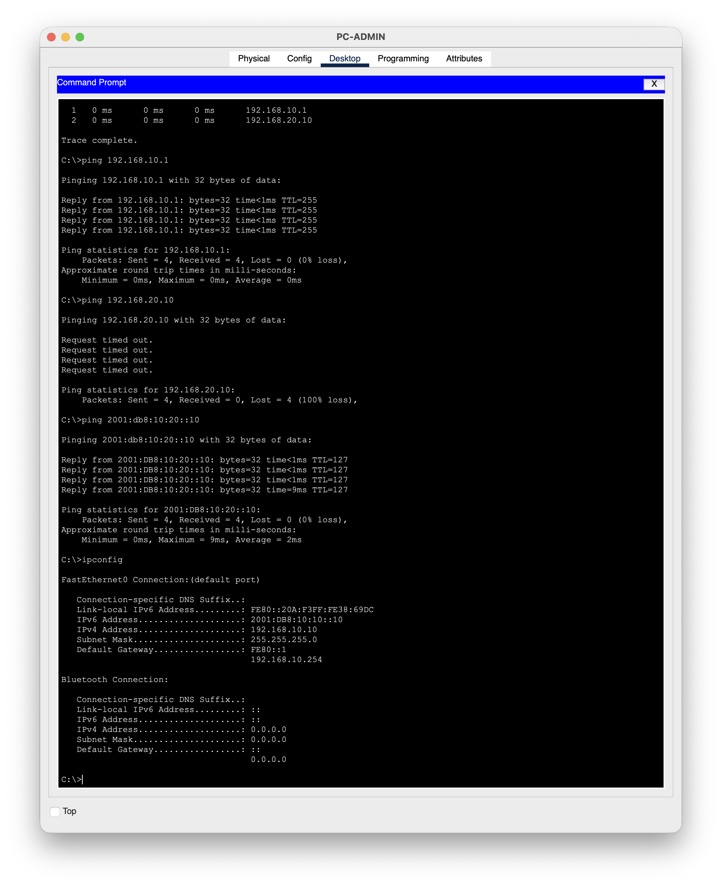
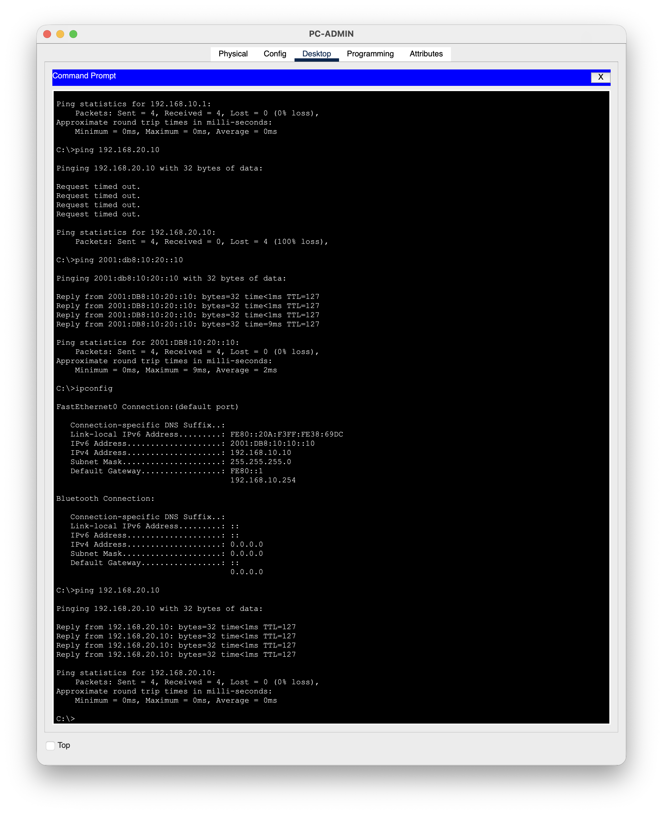

# TKT-002: User cannot reach internal server - incorrect default gateway

| Field | Value |
|---|---|
| Priority | P3 (single user, workaround: none) |
| Category | Network - endpoint configuration |
| Reported by | PC-ADMIN user, Administration |
| Affected service | Access to SRV-INTERNAL (192.168.20.10) over IPv4 |
| Opened / resolved | 2026-10-20 / 2026-10-20 |
| Resolved at | Level 1 (no escalation needed) |

## Symptom
User reports "the server is down". The user cannot reach SRV-INTERNAL by IPv4.

## Scope
- One user affected. Other Admin LAN devices: not tested (only one PC in lab).
- IPv6 access to the same server works, so the server and router are up.

## Investigation

| Test | Result | Conclusion |
|---|---|---|
| `ping 192.168.10.1` (gateway) | Success | Layer 1-3 to router is fine |
| `ping 192.168.20.10` (server) | Request timed out | Traffic leaves the LAN incorrectly |
| `ping 2001:db8:10:20::10` | Success | Server and routing are up |
| `ipconfig` | Default Gateway `192.168.10.254` | Gateway does not exist on this LAN |

## Root cause
PC-ADMIN had its IPv4 default gateway set to `192.168.10.254` instead of the router address `192.168.10.1`. Traffic for other networks was sent to a device that does not exist.

## Fix
Changed the PC-ADMIN IPv4 default gateway to `192.168.10.1`.

## Verification
`ping 192.168.20.10` returned 4/4 replies with TTL=127.

## Customer update sent
"Hi, the issue was a setting on your PC that told it the wrong route to other networks. I've corrected it and confirmed you can reach the server. Please let me know if anything still isn't working."

## Prevention
Hand out addresses with DHCP so gateways are not typed by hand (Project 04).

## CCNA objective
1.10 Verify IP parameters for client OS
