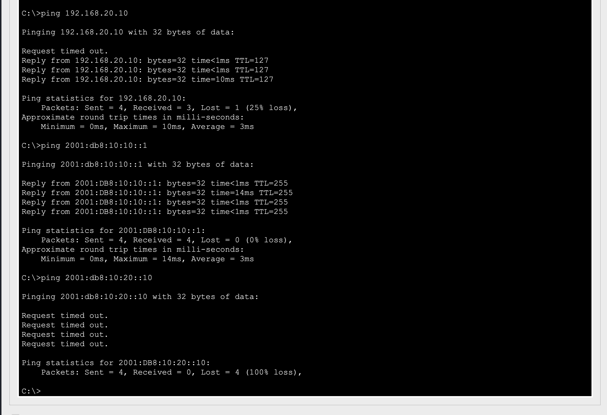
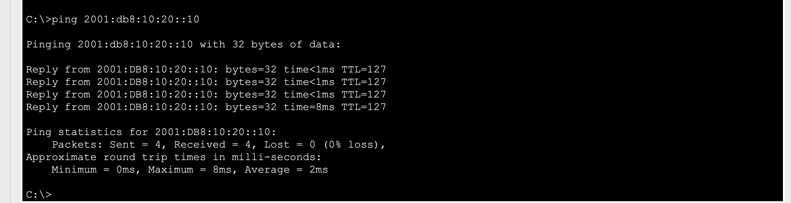

# TKT-004: IPv6 traffic to server failing, IPv4 working - IPv6 routing disabled

| Field | Value |
|---|---|
| Priority | P3 (partial outage, IPv4 still working) |
| Category | Network - routing (IPv6) |
| Reported by | Monitoring / Administration team |
| Affected service | IPv6 access to Server LAN 2001:db8:10:20::/64 |
| Opened / resolved | 2026-10-20 / 2026-10-20 |
| Resolved at | Level 1 |

## Symptom
IPv6 connections to SRV-INTERNAL fail. IPv4 connections to the same server work.

## Scope
- IPv4 to the server works, so cabling, interfaces and the server are fine.
- The IPv6 gateway (2001:db8:10:10::1) answers, so IPv6 addressing on the LAN is fine.
- The fault is in IPv6 forwarding between networks.

## Investigation

| Test | Result | Conclusion |
|---|---|---|
| PC: `ping 192.168.20.10` | Success | IPv4 path is healthy |
| PC: `ping 2001:db8:10:10::1` | Success | IPv6 on the local LAN is fine |
| PC: `ping 2001:db8:10:20::10` | Failed | IPv6 is not being routed |
| R1-HQ: `show running-config \| include ipv6` | `ipv6 unicast-routing` missing | Router will not forward IPv6 |

Evidence: [router output](../verification/TKT-004_R1-HQ_before.txt)

## Root cause
`ipv6 unicast-routing` had been removed from R1-HQ. Without it, a Cisco router answers IPv6 traffic addressed to itself but does not forward IPv6 between interfaces.

## Fix

    R1-HQ(config)# ipv6 unicast-routing
    R1-HQ# copy running-config startup-config

## Verification
`ping 2001:db8:10:20::10` from PC-ADMIN: 4/4 replies.

## Lesson
Testing IPv4 and IPv6 separately, and testing the gateway before the far end, narrowed the fault to one command in under five minutes. In a dual-stack network, "it works on IPv4" does not mean the network is healthy.

## Customer update sent
"IPv6 traffic between your office and server networks was not being routed due to a router setting. This has been corrected and tested. IPv4 services were not affected."

## Prevention
Keep a baseline config and compare after every change (`show archive config differences` on real IOS, or a scripted config backup - Project 06).

## CCNA objective
1.8 Configure and verify IPv6 addressing and prefix · 3.3 IPv6 routing
